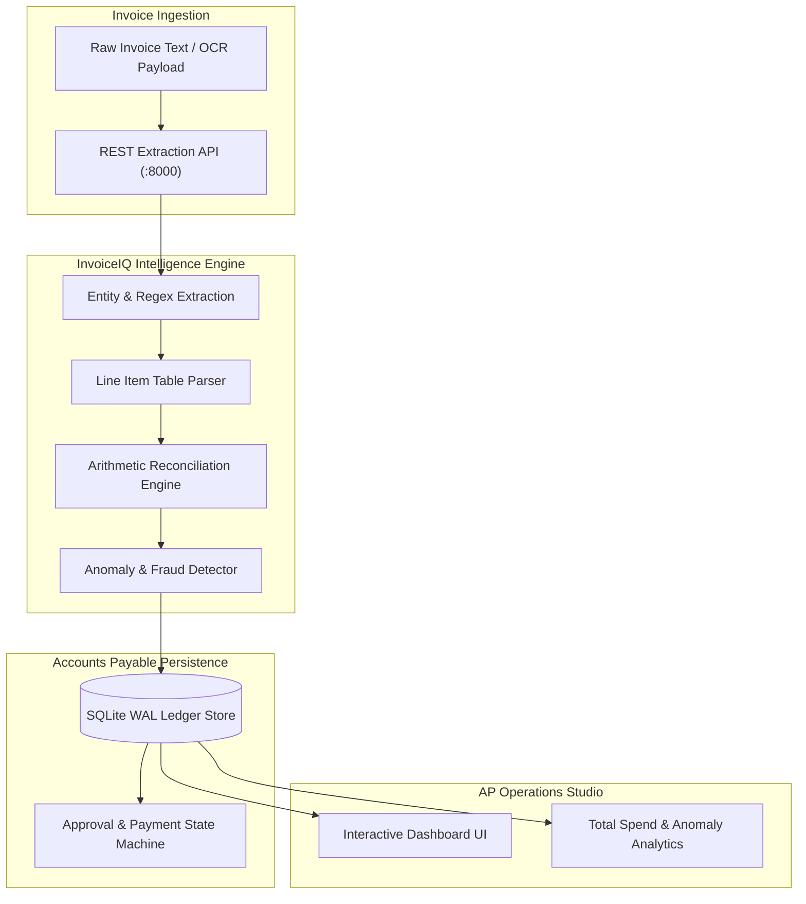

# InvoiceIQ — Intelligent Invoice Extraction & Accounts Payable Platform

[](https://github.com/Soulofghost/invoiceiq/actions)
[](LICENSE)
[](https://www.python.org/)
[](https://fastapi.tiangolo.com)
[]()

> **InvoiceIQ** is an enterprise-grade intelligent invoice extraction, mathematical reconciliation, and Accounts Payable (AP) workflow automation platform. Engineered with FastAPI, SQLite WAL persistence, and NLP regex heuristics, it extracts key financial entities from unstructured invoices, performs cross-field line item verification, flags fraudulent or abnormal tax rates, and streamlines AP payment approvals.

---

## 1. Problem Statement

Corporate accounting and procurement departments process thousands of supplier invoices monthly through manual review:
- **Manual Data Entry Burden:** AP clerks manually transcribe invoice numbers, dates, line items, and totals into ERP systems, introducing costly human errors.
- **Silent Arithmetic Inconsistencies:** Subtle rounding discrepancies, miscalculated sales taxes, or faulty line totals slip past manual reviews and result in overpayment.
- **Billing Fraud & Abnormal Rates:** Bogus invoices with inflated tax rates, missing vendor tax IDs, or duplicate invoice numbers drain corporate treasuries without automated detection.
- **Lack of Centralized Auditability:** Approval states are scattered across email threads and PDFs, complicating SOX compliance and financial audits.

---

## 2. Core Value Proposition

InvoiceIQ delivers an autonomous, auditable, and resilient invoice processing engine:
- **Heuristic Entity Extraction:** Extracts invoice identifiers, supplier names, tax IDs, invoice/due dates, and multi-line item breakdowns from raw text or OCR payloads in sub-second execution windows.
- **Autonomous Arithmetic Reconciliation:** Mathematically verifies that $\sum \text{Line Items} = \text{Subtotal}$ and $\text{Subtotal} + \text{Tax} = \text{Total Due}$, immediately highlighting any penny discrepancy.
- **Proactive Anomaly Flagging:** Automatically flags statutory tax rate breaches ($> 35\%$), missing vendor identifiers, and un-reconciled totals.
- **Enterprise AP Ledger & State Machine:** Manages the full AP invoice lifecycle from `PENDING_REVIEW` to `VERIFIED`, `APPROVED`, and `PAID`.
- **Interactive AP Studio:** Includes a single-page management console with live extraction sandboxes, template presets, and real-time spend analytics.

---

## 3. System Architecture

The following diagram illustrates the flow of raw invoice data through InvoiceIQ's extraction and verification pipeline:



---

## 4. Entity Extraction & NLP Heuristic Engine

InvoiceIQ uses boundary-enforced regular expression heuristics to isolate critical financial data:
- **Invoice Number:** `\b(?:Invoice\s*(?:#|No\.?|Number)?[:\s]*)([A-Z0-9\-_]+)`
- **Dates:** Normalized `YYYY-MM-DD` or `MM/DD/YYYY` for both invoice creation and payment due dates.
- **Supplier Identification:** Regex extraction of vendor trade names and corporate tax/VAT/EIN identifiers.
- **Currency Symbols:** Multi-currency detection supporting USD (`$`), EUR (`€`), GBP (`£`), and JPY (`¥`).
- **Line Items:** Dynamic capture of tabular row items preserving description, unit quantity, unit price, and extended row total.

---

## 5. Mathematical Line Item Reconciliation

Every parsed invoice is evaluated against strict arithmetic equality constraints:

$$\Delta_{\text{lines}} = \left| \sum_{i=1}^{n} (\text{quantity}_i \times \text{unit\_price}_i) - \text{Subtotal} \right| \le 0.05$$
$$\Delta_{\text{total}} = \left| (\text{Subtotal} + \text{Tax}) - \text{Total Due} \right| \le 0.05$$

If either constraint is violated ($\Delta > 0.05$), the invoice is marked `is_reconciled = False` and tagged with an `ARITHMETIC_RECONCILIATION_FAILED` anomaly alert for AP manager review.

---

## 6. Technology Stack

- **Backend Framework:** FastAPI 0.115+ (Python 3.11+)
- **Database Engine:** SQLite 3 with Write-Ahead Logging (WAL) mode
- **Data Validation:** Pydantic v2 schemas with strict typing
- **Testing:** Pytest & HTTPX TestClient
- **Frontend Console:** Vanilla HTML5, CSS Custom Properties, Space Grotesk, JetBrains Mono
- **Containerization:** Docker multi-stage Alpine build & Docker Compose

---

## 7. REST API Endpoints

### Extraction & Processing
- `POST /api/v1/invoices/extract` — Extract entities, parse line items, and run arithmetic reconciliation on raw invoice text.
- `POST /api/v1/invoices` — Record and persist an extracted invoice into the AP ledger.
- `GET /api/v1/invoices` — List all invoices with optional `?status=` filtering.
- `GET /api/v1/invoices/{id}` — Retrieve detailed invoice record including line item breakdown and anomalies.
- `PATCH /api/v1/invoices/{id}/status` — Transition invoice status (`PENDING_REVIEW` -> `VERIFIED` -> `APPROVED` -> `PAID`).

### Analytics & Health
- `GET /api/v1/analytics/summary` — Aggregate financial KPIs (total spend, approved spend, pending count, reconciliation index).
- `GET /api/v1/health` — Service health and extraction capability probe.

---

## 8. Directory Structure

```text
invoiceiq/
├── .github/
│   └── workflows/
│       └── ci.yml               # Automated GitHub Actions test pipeline
├── backend/
│   ├── app/
│   │   ├── engine/
│   │   │   ├── __init__.py
│   │   │   └── extractor.py     # Heuristic regex & reconciliation engine
│   │   ├── routers/
│   │   │   ├── __init__.py
│   │   │   └── invoices.py      # Invoice REST endpoints
│   │   ├── __init__.py
│   │   ├── config.py            # Environment configuration
│   │   ├── database.py          # SQLite schema & connection manager
│   │   ├── main.py              # FastAPI app and static mount
│   │   └── schemas.py           # Pydantic data models
│   ├── tests/
│   │   ├── __init__.py
│   │   ├── test_api.py          # REST integration tests
│   │   └── test_extractor.py    # Entity parser & math verification tests
│   └── requirements.txt
├── frontend/
│   ├── index.html              # Accounts Payable dashboard UI
│   ├── style.css               # Bespoke FinTech dark-mode styling
│   └── app.js                  # Frontend controller & parser sandbox
├── Dockerfile                  # Container definition
├── docker-compose.yml          # Container orchestration
├── .env.example
├── .gitignore
├── LICENSE                     # MIT License
└── README.md
```

---

## 9. Getting Started

### Prerequisites
- Python 3.11 or higher
- Git

### Installation
```bash
# Clone the repository
git clone https://github.com/Soulofghost/invoiceiq.git
cd invoiceiq

# Create virtual environment
python -m venv .venv
source .venv/bin/activate  # On Windows: .venv\Scripts\activate

# Install dependencies
pip install -r backend/requirements.txt
```

### Running Locally
```bash
cd backend
uvicorn app.main:app --reload --port 8000
```
Open your browser at `http://localhost:8000` to access the Accounts Payable Extraction Studio.

---

## 10. Automated Testing

The automated test suite verifies entity extraction, arithmetic reconciliation bounds, anomaly triggers, and REST API contracts:

```bash
pytest backend/tests -v
```

Expected output:
```text
backend/tests/test_api.py::test_health_check PASSED
backend/tests/test_api.py::test_analytics_summary PASSED
backend/tests/test_api.py::test_extract_endpoint PASSED
backend/tests/test_api.py::test_invoice_crud_and_status_transition PASSED
backend/tests/test_extractor.py::test_extract_invoice_data_nominal PASSED
backend/tests/test_extractor.py::test_extract_invoice_data_arithmetic_mismatch PASSED
backend/tests/test_extractor.py::test_extract_abnormal_tax_rate PASSED
backend/tests/test_extractor.py::test_currency_parser PASSED
backend/tests/test_extractor.py::test_clean_num PASSED

======================== 9 passed in 0.60s ========================
```

---

## 11. Docker Deployment

Deploy with Docker Compose:
```bash
docker-compose up -d --build
```

Verify service status:
```bash
docker-compose ps
curl http://localhost:8000/api/v1/health
```

---

## 12. Author & License

- **Author:** Alvin MS ([@Soulofghost](https://github.com/Soulofghost))
- **License:** [MIT License](LICENSE) — Open source and production ready.
